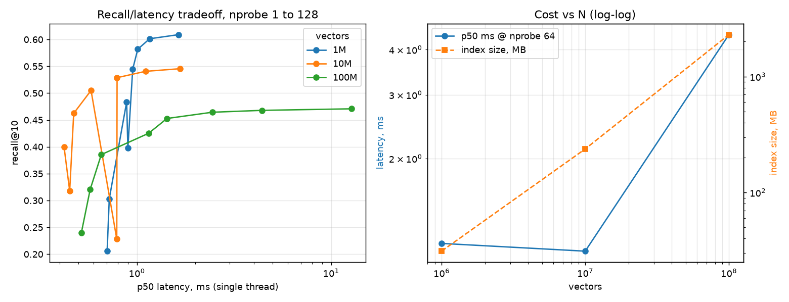

# vecdb — a sharded vector database on FAISS

IVF-PQ indexes with exact re-ranking, an id/metadata store, atomic persistence, gRPC shard servers and a
scatter-gather router, plus a Gemini RAG app on top. Built to work up to 1B vectors on one rented box.

**1M real BigANN (SIFT) vectors: recall@10 0.959 at 0.92 ms p99** on one core of an Apple M1 laptop
(IVF4096,PQ16, nprobe 64, exact re-rank of the top 100). The index is 33 MB; the exact vectors kept for re-ranking are 496 MB.

**100M real BigANN vectors on the same 8 GB laptop:** a 2.2 GB IVF-PQ index (vs 11.9 GB raw), streamed in over HTTP, answering at 10 ms p99.

Full explanation of every concept: [`docs/VectorDB_Explained.pdf`](docs/VectorDB_Explained.pdf).

## Architecture

```
client ──gRPC──> router (vdb_day7_router.py)          same service as a shard
                   │  fan-out in parallel, k-way heap merge, timeouts, partial results
        ┌──────────┼──────────┬──────────┐
     shard 0    shard 1    shard 2    shard 3          vdb_day6_shard.py, ids where id % 4 == shard
     index.faiss (IVF-PQ) · raw.faiss (re-rank) · meta.sqlite (id -> JSON) · config.json
```

| File | What it is |
|---|---|
| `vdb_day5_db.py` | `VectorDB`: add/search/save/load, global ids, SQLite metadata, re-rank, mmap, thread safety |
| `vdb_day5_rag.py` | RAG on the DB: ingest once, calibrated similarity floor stored with the data, Gemini answers |
| `vecdb.proto` | gRPC service + messages (vectors travel as raw bytes) |
| `vdb_day6_shard.py` | one shard = one process serving one DB directory |
| `vdb_day7_router.py` | scatter-gather router (library and server) |
| `vdb_day7_bench.py` | 1 vs N shards end to end; also benchmarks remote shards on the cloud box |
| `vdb_build_100m.py` | streams BigANN over HTTP into IVF-PQ with checkpoints; `--offset` builds 1B shards |
| `vdb_scaling_curve.py` | turns the 1M / 10M / 100M runs into one table, chart and 1B projection |
| `tests/test_vdb.py` | 13 tests, including "4 shards behind the router == one database, exactly" |

## Run it

```bash
python -m venv .venv && .venv/bin/pip install -r requirements.txt
.venv/bin/python -m pytest tests -q                       # 13 passed

.venv/bin/python vdb_day5_db.py --n 1000000               # 1M build + recall/latency sweep
.venv/bin/python vdb_day7_bench.py --n 1000000 --shards 4 # 1 vs 4 shards through gRPC

# RAG (needs GEMINI_API_KEY in .env)
.venv/bin/python vdb_day5_rag.py ingest data/facts.txt
.venv/bin/python vdb_day5_rag.py calibrate
.venv/bin/python vdb_day5_rag.py ask "why does the brain need sleep?" --temperature 0.2
```

## Results

All latency numbers are single queries, one thread per process, after warmup, 1,000 BigANN queries,
on an Apple M1 (8 cores, 8 GB RAM), index in RAM.

**In-process, 1M vectors, IVF4096,PQ16** (`results_day5_N1000000.json`)

| nprobe | re-rank | recall@10 | p50 ms | p99 ms |
|---|---|---|---|---|
| 16 | off | 0.561 | 0.22 | 0.29 |
| 16 | 100 | 0.822 | 0.33 | 0.45 |
| 64 | off | 0.596 | 0.44 | 0.60 |
| 64 | 100 | **0.959** | 0.63 | **0.92** |

Without re-ranking, recall stops near 0.6 however many lists you scan (PQ precision is the limit). With
re-ranking, nprobe works as a recall dial again.

**Through gRPC + router** (`results_day7_N1000000.json`)

| config | nprobe | re-rank | recall@10 | p50 ms | p99 ms |
|---|---|---|---|---|---|
| 1 shard (IVF4096) | 64 | 100 | 0.959 | 1.41 | 2.71 |
| 4 shards (IVF2048 each) | 64 | 100 | 0.985 | 3.17 | 5.60 |

On one laptop, sharding buys recall (each shard scans 4x more of its data in total) but costs latency: the
RPC hop adds ~1–2 ms, and 4 shard processes on shared cores show tail amplification (p99 up to 26 ms at
some settings). Sharding pays off when the data does not fit on one machine, which is the 1B case.

**Scaling 1M -> 10M -> 100M on one laptop** (`results_scaling.json`, `results_scaling.png`;
IVF16384,PQ16, nprobe 64, no re-ranking, single thread)

| N | index on disk | raw uint8 | recall@10 | p50 ms | p99 ms | batch QPS |
|---|---|---|---|---|---|---|
| 1M | 31.1 MB | 122.1 MB | 0.601 | 1.16 | 1.88 | 2,527 |
| 10M | 237.1 MB | 1.2 GB | 0.541 | 1.11 | 2.30 | 4,164 |
| 100M | 2.2 GB | 11.9 GB | 0.468 | 4.40 | 10.04 | 714 |



What the curve says:
- **Memory is exactly linear:** about 24 bytes per vector, so 1B projects to a ~22 GB index.
- **Latency grows once lists get long:** nlist is fixed, so each 10x in N puts 10x more vectors in every
  list; 10M -> 100M cost ~4x at p50. The fix at 1B is a larger nlist (~sqrt(N)) or sharding, which
  `vdb_day7_router.py` already does.
- **Recall without re-ranking falls from 0.60 to 0.47:** PQ16 compression is the ceiling (nprobe 128 barely
  helps). At 100M the 8 GB laptop cannot also hold the 12 GB of raw vectors for re-ranking; at 1M,
  re-ranking lifts the same kind of index from 0.60 to 0.96 (table above).

**1B vectors: not run yet** (needs a rented machine). The runbook is in section 18 of the PDF
(4 x 250M shards built with `vdb_build_100m.py --offset`, served with `vdb_day6_shard.py --index`,
measured with `vdb_day7_bench.py --connect`). Memory: ~22 GB of IVF-PQ16 index vs 119 GB raw uint8
(512 GB as float32).

## Learning series

`day1_vectorstore.py` ... `day6_hnsw.py` build the ideas from scratch before FAISS takes over: brute force,
embeddings, a first RAG, temperature/top-p sampling, approximate search, LSH and HNSW.

## Scope

In: persistence, ids + metadata, re-rank, mmap, gRPC sharding, partial-failure handling, streaming builds.
Out (on purpose): write-ahead log, deletes, replication, auth, filtering by metadata during search.
